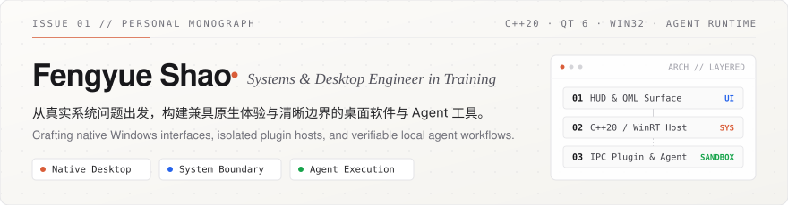
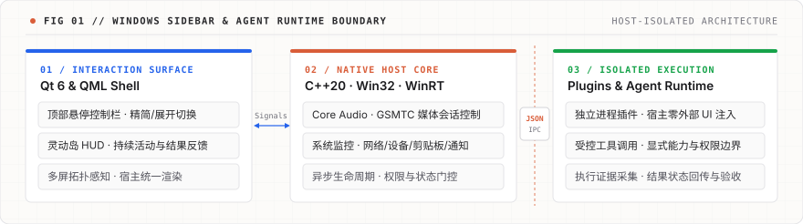

  <picture>
    <source media="(prefers-color-scheme: dark)" srcset="./assets/header-dark.svg" />
    <source media="(prefers-color-scheme: light)" srcset="./assets/header-light.svg" />
    
  </picture>

 

**`01 // THESIS & FOCUS`**

我是一名关注 **Windows 原生桌面工程、系统接口与 Agent 运行时** 的学生开发者，主力技术栈为 **C++20、Qt 6 与 QML**。

相比孤立的 Demo，我更倾向于从真实使用场景出发，把底层系统能力打磨成可日常运行的工具——从界面交互帧率、异步线程生命周期，到跨进程插件隔离与 Agent 执行结果的验收闭环，均视为同一工程整体的不同切面。

<table>
  <tr>
    <td width="33%" valign="top">
      <code>DESKTOP SHELL</code> 
      <strong>原生桌面与交互架构</strong>  
      持续迭代 <b>Windows Sidebar</b>，将系统遥测、音频媒体控制、设备状态与低打扰桌面交互整合于统一的 Qt Quick / WinRT 宿主之中。
    </td>
    <td width="33%" valign="top">
      <code>RUNTIME BOUNDARY</code> 
      <strong>跨进程隔离与插件协议</strong>  
      设计受限 JSON IPC 插件与 C++ Agent 接入架构。宿主不加载外部 UI 代码，通过显式的能力声明、权限门控与状态管理保障系统边界安全。
    </td>
    <td width="33%" valign="top">
      <code>VERIFIABLE AGENT</code> 
      <strong>端侧模型与可验证工作流</strong>  
      基于本地推理服务实践工具调用与任务编排，重点探索「任务契约 — 执行证据 — 结果验收」的人机协作闭环。
    </td>
  </tr>
</table>

 

**`02 // FLAGSHIP SYSTEM`**

### Windows Sidebar &nbsp;`C++20` · `Qt 6 / QML` · `Win32 / WinRT` · `Core Audio` · `JSON IPC`

一个围绕 Windows 日常高频操作构建的原生桌面控制中心。项目由早期侧边监控栏演进为**顶部悬停唤出控制栏 + 灵动岛活动视图**的双层交互形态，兼顾即用性与极简视觉克制。

  <picture>
    <source media="(prefers-color-scheme: dark)" srcset="./assets/architecture-dark.svg" />
    <source media="(prefers-color-scheme: light)" srcset="./assets/architecture-light.svg" />
    
  </picture>

- **桌面交互层（Interaction Surface）**：支持精简/展开态平滑切换、自动隐藏、多显示器拓扑选择与模块化主题配置；通过**灵动岛（Dynamic Island HUD）**聚合后台持续活动、提醒与即时操作反馈（自由桌面卡片处于可选预览阶段）。
- **原生系统集成（Native System Integration）**：深度对接 `Win32`、`C++/WinRT` 与 `Core Audio`，覆盖系统资源监控、基于 GSMTC 的全局媒体会话控制、网络与外设状态、系统通知及剪贴板流转。
- **沙箱插件与 Agent 演进（Isolated Plugin & Agent Boundary）**：插件以独立子进程运行，经由受限 JSON 协议与宿主通信，杜绝第三方 UI 代码直接注入主进程；正在规划将这一能力边界向本地 Agent 开放，使人类用户与 Agent 共用一套可审计、可回滚的桌面工具接口 *(源码暂未公开)*。

 

**`03 // APPLIED EXPLORATIONS`**

<table>
  <tr>
    <td width="50%" valign="top">
      <h4>Local LLM &amp; Agent Engineering &nbsp;<code>AI SYSTEMS</code></h4>
      <ul>
        <li><b>端侧推理与工具链</b>：使用 <code>llama.cpp</code> 部署本地模型服务，验证低延迟结构化输出与确定性函数调用。</li>
        <li><b>数据与语义桥接</b>：实践 <code>RAG</code> 与 <code>NL2SQL</code>（基于 PostgreSQL），打通自然语言意图、Schema 约束与关系型查询验证。</li>
        <li><b>可验收执行流</b>：研究 Agent 任务描述规范、运行期证据采集（Execution Evidence）与分步验收机制。</li>
      </ul>
    </td>
    <td width="50%" valign="top">
      <h4>Vision, Graphics &amp; Embedded &nbsp;<code>LOW-LEVEL &amp; PERCEPTION</code></h4>
      <ul>
        <li><b>计算机视觉（OpenCV）</b>：完成棋盘格相机标定、畸变校正、Harris 角点检测、ArUco 姿态估计与 <code>solvePnP</code> 实践。</li>
        <li><b>现代图形接口（Vulkan）</b>：基于 <code>Vulkan-Hpp RAII</code> 与 <code>GLFW</code> 构建现代显式渲染管线基础流程。</li>
        <li><b>微控制器开发（Pico 2 W）</b>：使用 C/C++ SDK 与 <code>I²C</code> 协议编写驱动并控制 OLED 显示模块。</li>
      </ul>
    </td>
  </tr>
</table>

 

**`04 // TECHNICAL MATRIX & METHODOLOGY`**

| Domain | Core Stack & Practical Scope |
| :--- | :--- |
| **`Languages`** | **C++17 / C++20** · **C** · **Python** · **QML** |
| **`Desktop & OS`** | **Qt 6 / Qt Quick** · **Win32 API** · **C++/WinRT** · **Core Audio** · **GSMTC** |
| **`AI & Data Systems`** | **llama.cpp** · **Tool Calling & Agent Runtime** · **RAG** · **NL2SQL** · **PostgreSQL** |
| **`Vision & Graphics`** | **OpenCV** *(Calibration / ArUco / `solvePnP`)* · **Vulkan** *(Vulkan-Hpp RAII)* · **GLFW** |
| **`Hardware & Tooling`** | **Raspberry Pi Pico SDK** *(I²C / OLED)* · **CMake** · **MSVC** · **Git** · **Docker** |

 

> **Engineering Approach** — 从项目中的具体工程问题切入，先建立能够清晰解释 *“Why & How”* 的系统模型与边界假设，再以最小完备代码验证，按需向底层深入。

 

  <picture>
    <source media="(prefers-color-scheme: dark)" srcset="./assets/colophon-dark.svg" />
    <source media="(prefers-color-scheme: light)" srcset="./assets/colophon-light.svg" />
    
  </picture>

